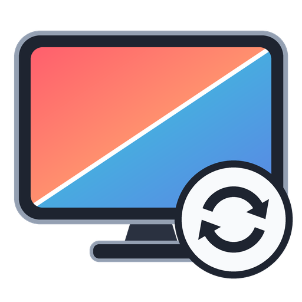
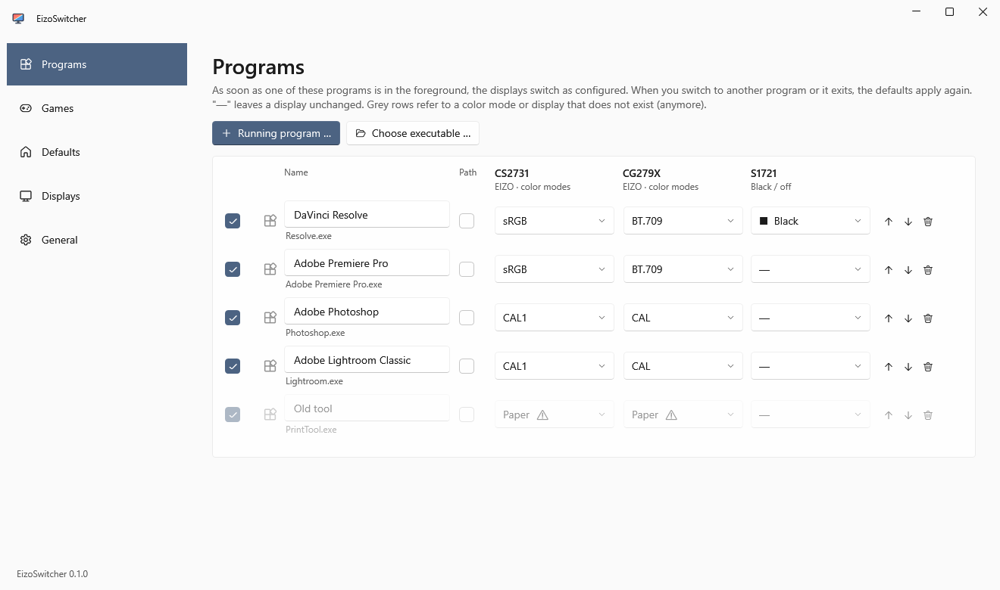
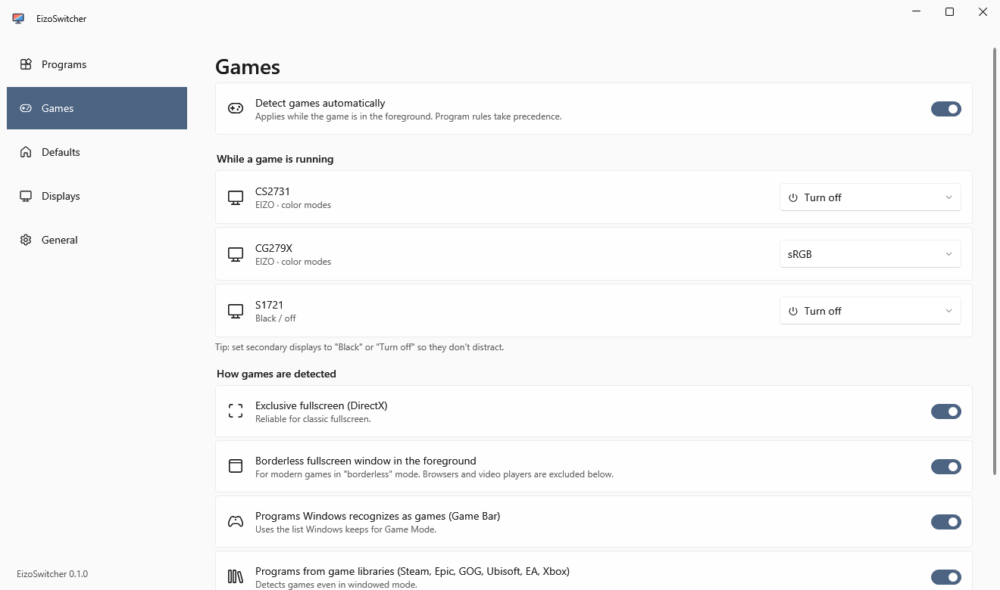
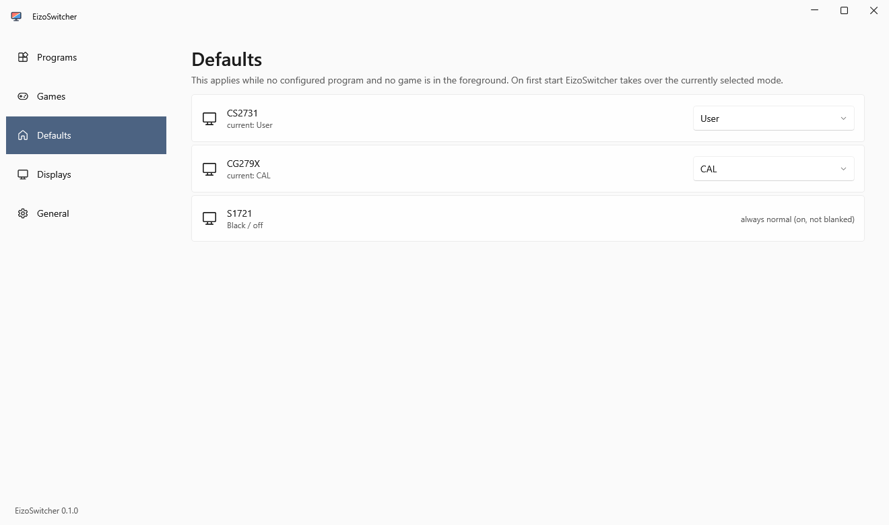
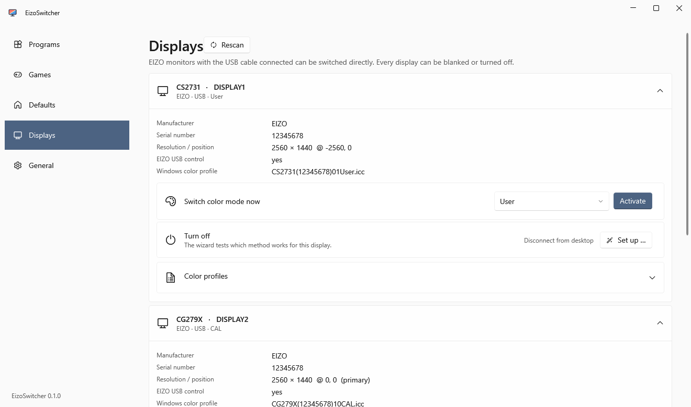
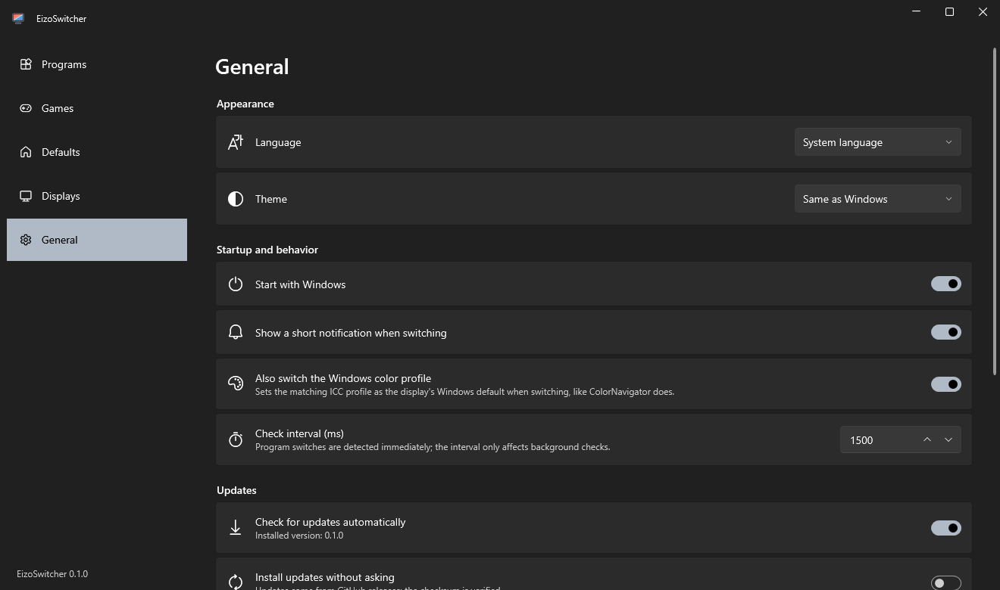

<p align="center">
  
</p>

<h1 align="center">EizoSwitcher</h1>

<p align="center">
  <b>The right color mode for every program – automatically.</b><br>
  Switches EIZO ColorEdge color modes over USB and blanks distracting displays while you work or play.
</p>

<p align="center">
  <a href="https://github.com/s1nn3r/EizoSwitcher/releases/latest"></a>
  
  <a href="LICENSE"></a>
  <a href="#-buy-me-a-coffee"></a>
</p>

---

## Why I built this

Hi, I'm Marc – photographer, video editor and programmer.

On my desk sit two EIZO ColorEdge monitors, and for years I did the same little dance every single day: open **DaVinci Resolve** → dig out ColorNavigator → switch to **BT.709**. Back to **Photoshop** → switch to my **CAL** calibration. Start a game in the evening → **sRGB**, while the second screen keeps glaring at me from the side. And every time I forgot, I graded a clip in the wrong color space and only noticed it on someone else's screen.

ColorNavigator can switch modes – but only when *you* click. There is no "when this program runs, use that mode". So I took ColorNavigator apart, figured out how it talks to the monitors over USB and wrote the tool I always wanted:

**EizoSwitcher watches which programs are running and switches my monitors for me. When I close the program, everything goes back to normal.** No ColorNavigator required.



## What it does

- **Follows the program you work in** – the moment a program comes to the foreground, its settings apply; switch to another program and the defaults are back. One table with a column for every display: Resolve → BT.709 on the main screen, Photoshop → CAL, Lightroom → CAL on both.
- **Real EIZO color modes over USB** – it reads the mode names straight from the monitor (User, BT.709, sRGB, CAL, …). ColorNavigator can stay installed, but doesn't have to.
- **Every display, any brand** – any display can be blanked **black** or **turned off**. A small wizard finds out per display how it can be turned off (DDC/CI or disconnecting it from the desktop). Perfect for gaming without a bright second screen in the corner of your eye.
- **Game detection** – DirectX fullscreen, borderless fullscreen, the Windows game list and your Steam / Epic / GOG / Ubisoft / EA / Xbox libraries.
- **Windows color profile included** – together with the mode, EizoSwitcher sets the matching ICC profile as the display's Windows default, so Photoshop & co. color-manage correctly. It uses the profiles ColorNavigator created per mode, or any profile you pick.
- **Back to normal** – close the program and your defaults apply again. If you change a mode by hand on the monitor, EizoSwitcher respects it until the next program starts or ends.
- **Lives in the tray** – current mode per display at a glance, manual switching, pause. Settings in the Windows 11 style, light or dark.
- **Updates itself** from GitHub releases (checksum-verified, signature-checked once releases are signed).
- **Command line tool** `eizoswitch` for scripts, hotkeys and Stream Deck buttons.
- **8 languages** (English, Deutsch, Español, Français, Italiano, Nederlands, Polski, Português) and a **light / dark theme** – both follow Windows or can be set in the app.

## What you need

- Windows 10 or 11 (64-bit)
- the free [.NET 10 Desktop Runtime](https://dotnet.microsoft.com/download/dotnet/10.0) (x64) – if it is missing, EizoSwitcher offers the download link on first start. That's why the whole download is only about 3 MB.
- **For color modes:** an EIZO monitor with its **USB upstream cable** connected to the PC – the same cable ColorNavigator uses
- **For "turn off":** nothing special. If a monitor ignores DDC/CI power commands (like the EIZOs I tested), EizoSwitcher disconnects it from the desktop instead, so it goes to standby by itself. The primary display is blanked black instead.

Built and tested with a **CG279X** and a **CS2731** (USB) plus a **FlexScan S1721**. Other EIZO models that appear as *EIZO USB HID Monitor* in the Device Manager very likely work too – please [tell me](https://github.com/s1nn3r/EizoSwitcher/issues) about yours.

## Installation

1. Download **`EizoSwitcher-win-x64.zip`** from the [latest release](https://github.com/s1nn3r/EizoSwitcher/releases/latest).
2. Extract it into a folder you can write to, e.g. `%LOCALAPPDATA%\Programs\EizoSwitcher`.
   Please *not* under `C:\Program Files` – otherwise the automatic updates can't replace the files.
3. Start **`EizoSwitcher.exe`**. The icon appears in the tray, EizoSwitcher reads all your displays, takes over the currently selected modes as your defaults and opens the settings.

> If Windows SmartScreen complains about an unknown app: *More info → Run anyway*.

EizoSwitcher starts with Windows from now on (you can turn that off under *General*).

## Setting it up

### 1. Programs

Click **＋ Running program …** and pick the program (start it first), or choose an `.exe` with **＋ Choose executable …**. Then decide per display:

| Choice | What happens |
|---|---|
| **—** | the display is left alone |
| a color mode (e.g. `BT.709`) | the EIZO switches to this mode |
| **■ Black** | a black window covers the display – works with every monitor, click it to see the desktop again |
| **⏻ Turn off** | the display goes off – set up once per display under *Displays → Turn off → Set up …* |

- Only the program **in the foreground** counts. Clicking the taskbar, desktop or start menu keeps the current state; switching to any other program brings the defaults back.
- **Path** only triggers when the program runs from exactly that folder – handy for generic names like `launcher.exe`.
- A **grey row** points to a color mode or display that doesn't exist (anymore), e.g. after renaming a mode on the monitor. Hover it to see why.

### 2. Games



What should each display do while a game is running? My setup: `sRGB` on the main display, **Black** on the others. Program rules always take precedence over game detection.

### 3. Defaults



The mode each EIZO returns to when none of your programs and no game is running.

### 4. Displays



Everything EizoSwitcher knows about your displays, plus buttons to switch by hand and to test *Black*.

**Turn off → Set up …** starts a short wizard: it tries the methods one after the other – DDC/CI standby, DDC/CI power off, disconnecting the display from the desktop – for five seconds each and simply asks you whether the display went dark. The first method that works is remembered. Many monitors (including my EIZOs) acknowledge the DDC/CI commands but ignore them; disconnecting always works, Windows just rearranges the windows for a moment.

For EIZO displays you also choose the **color profile per mode** here. *Automatic* picks the profile ColorNavigator created for that mode (e.g. `CG279X(12345678)10CAL.icc`); you can also select any installed profile or *Leave unchanged*. The whole feature can be turned off under *General*.

### 5. General

Language, light/dark theme, autostart, notifications, updates.



## How games are detected

"Just check whether DirectX is in use" sounds tempting, but doesn't work: browsers, Office, Teams and half of Windows use DirectX too. There simply isn't one reliable signal, so EizoSwitcher combines four (each can be turned off):

1. **Exclusive fullscreen (DirectX)** – Windows itself reports when a Direct3D app runs in exclusive fullscreen. Very reliable, but many modern games use borderless mode instead.
2. **Borderless fullscreen window** – the window in the foreground covers its entire monitor. Browsers, video players and similar apps are excluded (the list is editable).
3. **Windows game list** – programs Windows has classified as games for Game Mode / Game Bar.
4. **Game libraries** – programs started from your Steam, Epic, GOG, Ubisoft, EA or Xbox library folders (plus any folder you add) that open a window. This catches games right at launch, even in windowed mode.

Like programs, a game only counts while it is in the foreground – Alt+Tab to a browser on the second screen and that screen comes back.

## The tray icon

Right-click it for:

- every display with its current mode and *why* it's active – click one to switch by hand or blank it
- **Pause automatic switching** – blanked or switched-off displays come back, nothing is switched until you resume
- **Settings …**, **Check for updates**, **Exit**

A left click opens the settings. Starting `EizoSwitcher.exe` a second time simply opens the settings of the instance that's already running.

## Command line

`eizoswitch.exe` comes along for scripts, hotkeys and Stream Deck buttons:

```
eizoswitch list                        connected EIZO monitors and their current mode
eizoswitch modes [monitor]             all color modes
eizoswitch get [monitor]               just the current mode
eizoswitch set [monitor] <mode>        switch (name or number)
eizoswitch list --json                 machine-readable output
```

`[monitor]` is the model or serial number and can be left out if only one EIZO is connected. Mode names are matched loosely, so `AdobeRGB` finds `Adobe®RGB`.

```
> eizoswitch set CG279X BT.709

  CG279X  CAL  →  BT.709  ✓
```

## Files

| What | Where |
|---|---|
| Settings | `%APPDATA%\EizoSwitcher\settings.json` |
| Log | `%APPDATA%\EizoSwitcher\EizoSwitcher.log` |
| Autostart | `HKCU\Software\Microsoft\Windows\CurrentVersion\Run` → `EizoSwitcher` |

## If something doesn't work

- **"No EIZO monitor found"** – check the USB cable between the monitor's USB upstream port and the PC. ColorNavigator isn't required, but may keep running.
- **"Turn off" doesn't work** – run *Displays → Turn off → Set up …* for that display. The primary display can't be disconnected and is blanked black instead.
- **The Windows color profile doesn't change** – check *General → Also switch the Windows color profile* and the profile per mode under *Displays*. "Automatic" needs the profiles ColorNavigator creates – if a mode was never used with ColorNavigator, pick a profile by hand.
- **Updates fail** – EizoSwitcher needs to live in a folder you can write to (see Installation). The release page opens so you can update by hand.
- Anything else: *General → Show log*, then [open an issue](https://github.com/s1nn3r/EizoSwitcher/issues) – I'm happy to help.

## Building from source

You need the [.NET 10 SDK](https://dotnet.microsoft.com/download).

```
dotnet build
.\tools\release.ps1 -Version 1.2.3                                   # package to artifacts\1.2.3
.\tools\release.ps1 -Version 1.2.3 -CertThumbprint <sha1>            # + Authenticode signing
.\tools\release.ps1 -Version 1.2.3 -CertThumbprint <sha1> -Publish   # + GitHub release
```

| Project | |
|---|---|
| `src/EizoSwitcher.Core` | USB HID protocol, monitor access, translations |
| `src/EizoSwitcher` | tray app (WPF with [WPF-UI](https://github.com/lepoco/wpfui)) |
| `src/EizoSwitcher.Cli` | `eizoswitch` command line tool |
| `tools/` | release script, icon renderer, translation helper |

**Translations** live in `src/EizoSwitcher.Core/Lang/*.json`, keyed by the English text. `python tools/extract_strings.py --check` lists missing entries. Corrections and new languages are very welcome as pull requests.

The USB protocol was reconstructed from ColorNavigator 7 and is documented in [PROTOCOL.md](PROTOCOL.md).

## ☕ Buy me a coffee

EizoSwitcher is free and will stay free. If it saves you a few clicks every day – or a grade in the wrong color space – I'd be really happy about a coffee:

<p>
  <a href="https://www.paypal.com/donate/?business=marc.breuer%40giant-online.de&currency_code=EUR&item_name=EizoSwitcher">
    
  </a>
</p>

PayPal: **marc.breuer@giant-online.de**

Thank you! ❤️

---

<sub>EIZO, ColorEdge, FlexScan and ColorNavigator are trademarks of EIZO Corporation. EizoSwitcher is an independent project and is not affiliated with or endorsed by EIZO. Use at your own risk. Licensed under the [MIT License](LICENSE).</sub>
