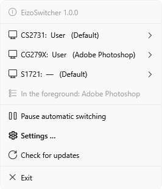

<p align="center">
  
</p>

<h1 align="center">EizoSwitcher</h1>

<p align="center">
  Switches the color mode of EIZO monitors depending on the program you're using.
</p>

<p align="center">
  <a href="https://github.com/s1nn3r/EizoSwitcher/releases/latest"></a>
  
  <a href="LICENSE"></a>
  <a href="#buy-me-a-coffee"></a>
</p>

---

## Why I built this

I'm Marc. I take photos, edit video and write software.

I have two EIZO ColorEdge monitors on my desk, and for years I switched their color modes by hand. Open DaVinci Resolve, open ColorNavigator, pick BT.709. Go back to Photoshop, pick my CAL calibration. Play a game in the evening, pick sRGB, and try to ignore the second screen glowing next to me. When I forgot, I graded a clip in the wrong color space and noticed only when I saw it on someone else's screen.

ColorNavigator can switch modes, but only when you click. You can't tell it to use a mode whenever a certain program is open. So I looked at how ColorNavigator talks to the monitors over USB and wrote the tool I wanted.

EizoSwitcher notices which program is in the foreground and sets the monitors accordingly. When I close the program, the monitors go back to my defaults. ColorNavigator doesn't need to be installed.


## Features

- You set a mode per program and per display in one table, for example BT.709 on the main screen for Resolve and CAL on both screens for Lightroom. The settings apply when the program comes to the foreground. If you briefly switch to your mail or the browser, the mode stays. Your defaults come back when the program exits or another program from the list takes over.
- The color modes come straight from the monitor over USB, with the names you see in its menu (User, BT.709, sRGB, CAL and so on). Modes you disabled in the monitor menu are listed last.
- Any display, from any maker, can be blanked or turned off while a program or game runs. A short wizard finds out how each display can be turned off.
- Games are detected automatically: exclusive fullscreen, borderless fullscreen, the Windows game list, and the Steam, Epic, GOG, Ubisoft, EA and Xbox libraries.
- With the mode, EizoSwitcher also sets the matching ICC profile as the Windows default for that display, so Photoshop and other color-managed programs use the right profile. It takes the profiles ColorNavigator created, or one you choose.
- The tray icon shows the current mode of each display and lets you switch by hand or pause the automatic switching. The settings window follows the Windows 11 look, in light or dark.
- Updates come from the GitHub releases. EizoSwitcher checks the checksum and the publisher signature and asks before it installs anything.
- A command line tool, `eizoswitch`, is included for scripts, hotkeys and Stream Deck buttons.
- The app is available in English, German, Spanish, French, Italian, Dutch, Polish and Portuguese.

## Requirements

- Windows 10 or 11, 64-bit.
- The free [.NET 10 Desktop Runtime](https://dotnet.microsoft.com/download/dotnet/10.0) (x64). If it's missing, the setup and the app offer the download link. This keeps the setup at about 2 MB.
- For color modes: an EIZO monitor whose USB upstream cable is connected to the PC. It's the same cable ColorNavigator uses.
- For turning displays off you don't need anything special. My EIZOs ignore the DDC/CI power commands, so EizoSwitcher disconnects such displays from the desktop instead, and they go to standby on their own. The primary display can't be disconnected and is covered in black.

I built and tested EizoSwitcher with a CG279X, a CS2731 and a FlexScan S1721. Other EIZO models that show up as *EIZO USB HID Monitor* in the Device Manager will probably work as well. If you try one, please [let me know](https://github.com/s1nn3r/EizoSwitcher/issues) how it went.

## Installation

1. Download `EizoSwitcher-Setup.exe` from the [latest release](https://github.com/s1nn3r/EizoSwitcher/releases/latest) and run it. It installs for your user account only, so you don't need admin rights. You can uninstall it under *Settings → Apps*.
2. Start EizoSwitcher. It reads your displays, uses the modes they're currently set to as your defaults, and opens the settings.

> The setup and the program are signed by *giant Computer Systems*. Windows SmartScreen may still warn you while the app is new and has few downloads. In that case click *More info → Run anyway*.

From then on EizoSwitcher starts with Windows (you can change this under *General*). When a new version is available it asks you first, then installs it in the background. If you'd rather not be asked, turn on *Install updates without asking*.

<details>
<summary>Portable version without the setup</summary>

Download `EizoSwitcher-win-x64.zip`, extract it to a folder you can write to (not `C:\Program Files`) and start `EizoSwitcher.exe`. Updates replace the files in that folder.
</details>

## Setting it up

### Programs

Click *Running program …* and pick the program from the list (it has to be running), or select its `.exe` with *Choose executable …*. Then choose what each display should do:

| Choice | Result |
|---|---|
| — | The display is left alone. |
| A color mode, e.g. `BT.709` | The EIZO switches to this mode. |
| ■ Black | A black window covers the display. This works with every monitor; click it to get the desktop back. |
| ⏻ Turn off | The display turns off. Set this up once per display under *Displays → Turn off → Set up* |

- The color mode stays until the program exits, even if you click into another program in between. If you want the defaults back as soon as you switch away, turn off *Keep the color mode until the program exits* under *General*. Black and off only last while the program is in front, so a second screen comes back as soon as you click something else.
- A rule is tied to the exact `.exe` you picked, and its folder is shown under the name. If you have Photoshop 2026 and the Photoshop beta installed, you create two rules. Generic names like `launcher.exe` therefore don't match every program that happens to use them.
- A grey row refers to a color mode or display that no longer exists, for example after you renamed a mode on the monitor. Hover over it to see why.

### Games


Here you choose what each display does while a game is running. I use sRGB on the main display and black on the other one. Program rules take precedence over game detection.

Some programs fill the whole screen without being games, for example a browser or a video player in fullscreen. EizoSwitcher ignores the programs listed under *Never treat as a game* at the bottom of this page. Browsers, video players, code editors, chat apps, Remote Desktop and virtual machines are already on the list. You add a program with *Running program …* or *Choose executable …* and remove it with *Remove* or the Del key. *Reset list* brings back the default entries.

If a program is still mistaken for a game, right-click the tray icon while it's detected and choose *Never treat "…" as a game*.

### Defaults


The mode each EIZO returns to when none of your programs and no game is in use.

### Displays


This page lists what EizoSwitcher knows about each display and has buttons to switch the mode by hand and to test black.

*Turn off → Set up* starts a short wizard. It tries DDC/CI standby, DDC/CI power off and disconnecting the display from the desktop, five seconds each, and asks you whether the display went dark. EizoSwitcher remembers the first method that works. Many monitors, including mine, accept the DDC/CI commands and then ignore them. Disconnecting always works; Windows rearranges the windows for a moment.

For EIZO displays you also pick the color profile per mode here. *Automatic* uses the profile ColorNavigator created for that mode, e.g. `CG279X(12345678)10CAL.icc`. You can choose any installed profile instead, or *Leave unchanged*. Profile switching can be turned off under *General*.

### General

Language, theme, autostart, notifications and updates.


## How games are detected

Checking whether a program uses DirectX doesn't help, because browsers, Office, Teams and large parts of Windows use it too. No single signal is reliable, so EizoSwitcher looks at four, and you can turn each one off:

1. Exclusive fullscreen. Windows reports when a Direct3D program runs in exclusive fullscreen. This is reliable, but many current games use borderless mode instead.
2. Borderless fullscreen. The window in the foreground covers its whole monitor. Browsers, video players, code editors, chat apps, Remote Desktop and similar programs are excluded. You can add your own under *Games → Never treat as a game*. If a program is mistaken for a game, the tray menu offers *Never treat "…" as a game* while it's detected.
3. The Windows game list, i.e. programs Windows has classified as games for Game Mode.
4. Game libraries: programs started from your Steam, Epic, GOG, Ubisoft, EA or Xbox folders, or from a folder you add. This catches games right at launch, even in windowed mode.

As with programs, black and off only last while the game is in the foreground. If you Alt+Tab to a browser on the second screen, that screen comes back. The color mode stays until the game exits.

## The tray icon



Right-clicking the icon shows each display with its current mode and the reason for it. From there you can switch a display by hand or blank it, pause the automatic switching, open the settings, check for updates or exit. While switching is paused, blanked or turned-off displays come back and nothing is switched.

A left click opens the settings. Starting `EizoSwitcher.exe` a second time also opens the settings of the running instance.

## Command line

`eizoswitch.exe` is installed alongside the app:

```
eizoswitch list                        connected EIZO monitors and their current mode
eizoswitch modes [monitor]             all color modes
eizoswitch get [monitor]               the current mode only
eizoswitch set [monitor] <mode>        switch (name or number)
eizoswitch list --json                 machine-readable output
```

`[monitor]` is the model name or serial number. You can leave it out if only one EIZO is connected. Mode names are matched loosely, so `AdobeRGB` finds `Adobe®RGB`.

```
> eizoswitch set CG279X BT.709

  CG279X  CAL  →  BT.709  ✓
```

## Files

| What | Where |
|---|---|
| Settings | `%APPDATA%\EizoSwitcher\settings.json` |
| Log | `%APPDATA%\EizoSwitcher\EizoSwitcher.log` |
| Autostart | `HKCU\Software\Microsoft\Windows\CurrentVersion\Run` → `EizoSwitcher` |

## Troubleshooting

- *No EIZO monitor found*: check the USB cable between the monitor's USB upstream port and the PC. ColorNavigator doesn't have to be installed, but it can keep running.
- *Turn off does nothing*: run *Displays → Turn off → Set up* for that display. The primary display can't be disconnected and is covered in black instead.
- *The Windows color profile doesn't change*: check *General → Also switch the Windows color profile* and the profile per mode under *Displays*. *Automatic* needs the profiles ColorNavigator creates. If you never used a mode with ColorNavigator, pick its profile by hand.
- *Updates fail*: EizoSwitcher has to be in a folder you can write to (see Installation). If an update fails, the release page opens so you can update by hand.
- For anything else, open *General → Show log* and [open an issue](https://github.com/s1nn3r/EizoSwitcher/issues). I'll try to help.

## Building from source

You need the [.NET 10 SDK](https://dotnet.microsoft.com/download), and for the installer [Inno Setup 6](https://jrsoftware.org/isinfo.php) (`winget install JRSoftware.InnoSetup`).

```
dotnet build
.\tools\release.ps1 -Version 1.2.3 -NoSign     # setup and zip in artifacts\1.2.3
```

| Project | |
|---|---|
| `src/EizoSwitcher.Core` | USB HID protocol, monitor access, translations |
| `src/EizoSwitcher` | tray app (WPF with the built-in Fluent theme, no UI library) |
| `src/EizoSwitcher.Cli` | `eizoswitch` command line tool |
| `installer/` | Inno Setup script for `EizoSwitcher-Setup.exe` |
| `tools/` | release script, icon renderer, translation helper |

Translations are in `src/EizoSwitcher.Core/Lang/*.json`, keyed by the English text. `python tools/extract_strings.py --check` lists missing entries. Pull requests with corrections or new languages are welcome.

I worked out the USB protocol from ColorNavigator 7; it's documented in [PROTOCOL.md](PROTOCOL.md).

## Buy me a coffee

EizoSwitcher is free and will stay free. If it saves you some clicks, or a grade in the wrong color space, I'd appreciate a coffee:

<p>
  <a href="https://www.paypal.com/donate/?business=marc.breuer%40giant-online.de&currency_code=EUR&item_name=EizoSwitcher">
    
  </a>
</p>

PayPal: marc.breuer@giant-online.de

Thanks!

---

<sub>EIZO, ColorEdge, FlexScan and ColorNavigator are trademarks of EIZO Corporation. EizoSwitcher is an independent project and is not affiliated with or endorsed by EIZO. Use at your own risk. Licensed under the [MIT License](LICENSE).</sub>
